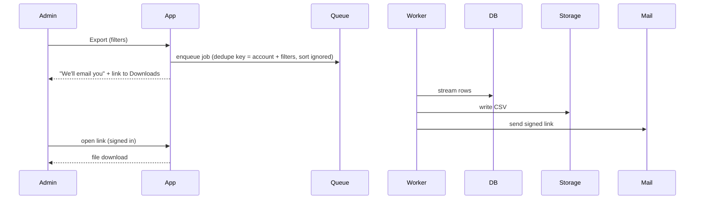

<!--
Worked example of a finished, approved spec at "Feature" size. Read it when you
want to see the target level of detail before writing your own, or to show a
user what they are about to approve.

It passes BOTH halves of the self-review, and both matter:
  - the linter, with 0 errors and 0 warnings (run from the skill directory):
      python3 -I scripts/spec_lint.py references/example-spec.md
  - the reading passes in references/self-review.md: every behavior described
    in sections 7 and 9 has an R row, every SC is delivered or measured, and
    every number appears once with one meaning.
A clean lint alone does not make a spec complete; the reading passes are what
catch a design that promises behavior no requirement carries.
The product and numbers are invented; the shape is the point.
-->

# Notify Me When My Export Is Ready

- **Status:** Approved
- **Author(s):** dana (with the assistant)
- **Date:** 2026-03-14
- **Sign-off needed from:** dana (requester); ravi (database on-call lead, for C4)
- **Approved by / on:** dana, 2026-03-14; ravi, 2026-03-16
- **Related:** issue #482 ("exports time out in the browser"), no prior spec

## 1. Problem

Account admins export order history to reconcile invoices at month end. Exports
over roughly 20k rows take 2-6 minutes. The browser request times out at 60
seconds, so admins re-click, which starts duplicate exports and slows the
database for everyone. Support logged 37 tickets about this in the last quarter,
and the slow-query log shows duplicate export queries on the first business day
of every month.

## 2. Users and context

- **Primary:** account admins, about 1,200 people, who export once or twice a
  month, usually on a desktop browser, often in batches across several accounts.
- **Also affected:** the support team (fewer tickets), the database on-call
  (less month-start load).

## 3. Success criteria

- **SC1:** An admin can start an export of up to 500k rows and receive the file
  without keeping the tab open.
- **SC2 (outcome):** Duplicate export queries on the first business day of the
  month fall from 40-60 (February baseline) to 0, measured by the slow-query
  log, read on the first month-start after full rollout.
- **SC3 (outcome):** Export-related support tickets fall from 37 last quarter to
  fewer than 5 per quarter, measured by the support desk's "export" tag, read
  at the end of the first full quarter after rollout.

## 4. Non-goals

- Scheduled or recurring exports (reason: nobody asked; one-off is the pain).
- New export formats beyond the current CSV (reason: no evidence of demand).
- Exports for non-admin roles (reason: permission model unchanged in this work).
- In-app notification center (reason: email plus the existing downloads page is
  enough to meet SC1; revisit if users ask).

## 5. Constraints and assumptions

- **C1:** Download links must not be guessable or usable by another account.
- **C2:** Generated files are deleted after 7 days (data-retention policy).
- **C3:** No new infrastructure; reuse the existing background job queue.
- **C4:** At most 2 export queries per account run against the shared
  database at once (database on-call runbook; confirmed by ravi).
- **Assumption:** every admin has a verified email address on file (inferred
  from the sign-up flow, which blocks unverified admins).
- **Assumption:** 500k rows is the largest real account today (stated by dana,
  from the billing dashboard).

## 6. Approaches considered

| Approach | How it works | Cost | Main risk | Reversible? | Meets |
|---|---|---|---|---|---|
| A. Background job + email link | Queue the export, email a signed link when done, list it on a Downloads page | M | Email delivery delays | Yes | SC1-SC3, C1-C4 |
| B. Background job + live push | Same job, but push a toast to the open tab over a socket | L | New socket infrastructure | Partly | SC2, SC3; misses SC1 (tab closed) and C3 |
| C. Make the query faster | Index and stream so the request finishes in under 60 s | M | 500k rows will still exceed 60 s | Yes | C1-C3; misses SC1, SC2 and C4 (re-clicks still run in parallel) |

**Chosen:** A, because it meets SC1 without the tab open and stays inside C3.
**Rejected:** B needs new infrastructure (C3) and still fails when the tab is
closed. C helps but cannot meet SC1 at 500k rows; its indexing idea moves to
planning notes as a cheap win.

## 7. Design

### 7.1 Overview

Clicking Export creates an export job and returns immediately. A worker builds
the CSV, stores it, and emails the requester a link. The Downloads page lists
the requester's exports from the last 7 days with their state.

### 7.2 Behavior and flows

If an identical job (same account and filters, in any sort order) is already
queued or running, the app returns that job instead of creating a new one
(R2). An account never has more than 2 jobs running; a third waits in
"queued" (R11).

### 7.3 Data

One new record type, the export job: account, requester, normalized filters,
dedupe key (account plus normalized filters; sort order excluded), state
(queued, running, ready, failed, expired), attempts, row count, file storage
key, created and finished times. Files live in the existing object store
under a per-account prefix and are deleted 7 days after creation (C2); the job
record stays 30 days, without the file, so 7.7 can count reuses and failures.
Nothing is backfilled; past synchronous exports are not migrated.

### 7.4 Interfaces

- **Export button (Orders page):** now starts a job and shows "We'll email
  you" with a link to Downloads, or "Already running" for a reused job.
- **Downloads page (existing, extended):** the requester's jobs from the last
  7 days with their state, plus Re-export on expired ones.
- **Signed file link:** opens only for a signed-in user of the same account
  (C1).
- **Emails:** three templates: ready (with link), no rows matched (no link),
  failed (with a support contact).

### 7.5 Edge cases and failure behavior

- Zero matching rows: the job completes and the email says "no rows matched"
  with no link (R9).
- Worker crash: the job is retried up to 3 times; after that the admin gets an
  email saying the export failed and support is notified (R8).
- Link opened after 7 days: the page says the file expired and offers a
  one-click re-export (R10).

### 7.6 Security and privacy

The link carries an unguessable token and also requires a signed-in session for
the same account (C1). Files are stored per account and deleted by the
retention job (C2).

### 7.7 Observability

- Per job: duration, row count, attempts and final state, emitted when the job
  ends. A dashboard shows p95 duration by row-count bucket, which is how R7's
  15-minute bound is watched in production.
- Alert: more than 5 failed jobs in an hour notifies the support channel.
  Whether it also pages the on-call is Q1.
- SC2: compare duplicate export queries in the slow-query log on the first
  business day before rollout (baseline, already captured) and after; the
  reused-job count shows dedupe working in between.
- SC3: count tickets with the support desk's "export" tag per quarter; no new
  instrumentation is needed.

### 7.8 Rollout and rollback

Behind a feature flag, enabled for 5 pilot accounts for one week, then all.
Rollback is turning the flag off; the old synchronous path stays until the
flag has been fully on for 30 days.

## 8. Requirements

| ID | Requirement | Acceptance check | Serves | Priority |
|---|---|---|---|---|
| R1 | Starting an export returns within 2 s and creates one export job | Given an account with 500k matching rows, when the admin clicks Export, then the response arrives in under 2 s and exactly one job row exists | SC1 | Must |
| R2 | An identical export already queued or running is reused, not duplicated; sort order does not make an export different | Given a running job for account X with filters F, when Export is clicked again with F in a different sort order, then the job count for X and F stays at 1 and the admin sees "Already running" | SC1, SC2 | Must |
| R3 | The requester receives an email with a download link when the job finishes | Given a finished job, when the worker completes, then exactly one email is sent to the requester within 60 s, containing a link to the file | SC1 | Must |
| R4 | The download link only works for a signed-in user of the same account | Given a valid link, when it is opened by a user of another account or signed out, then the response is 404 and no file bytes are sent | C1 | Must |
| R5 | Export files are deleted 7 days after creation | Given a file created 7 days and 1 hour ago, when the retention job runs, then the file is gone and its link shows "expired" | C2 | Must |
| R6 | The Downloads page lists the requester's exports from the last 7 days with state queued, running, ready, failed, or expired | Given 3 exports in states queued, ready and expired, when the admin opens Downloads, then all 3 appear with those states | SC1 | Should |
| R7 | An export of 500k rows completes and contains every matching row | Given an account with 500k matching rows, when the job runs on a production-size worker, then the CSV has a header plus exactly 500,000 data rows and is ready within 15 minutes | SC1 | Must |
| R8 | A failing job is retried up to 3 times, then reported once | Given a worker that crashes on every attempt, when the job fails a 3rd time, then it stops retrying, the requester gets exactly one failure email, support gets exactly one notice, and Downloads shows "failed" | SC1 | Must |
| R9 | An export that matches no rows tells the requester so | Given filters that match 0 rows, when the job finishes, then the requester gets one email saying "no rows matched" and it contains no download link | SC1 | Should |
| R10 | An expired link offers a re-export | Given a file removed by retention, when the requester opens its link, then the page says the file expired and its Re-export button creates one new job with the same filters | SC1, C2 | Should |
| R11 | An account runs at most 2 export jobs at once | Given an account with 2 running jobs, when a third export with different filters starts, then it stays "queued" until one of the 2 finishes | C4 | Must |

## 9. Risks

| Risk | Likelihood | Impact | Mitigation |
|---|---|---|---|
| Email lands in spam, admin never sees it | M | M | Downloads page (R6) is the fallback; link to it from the confirmation message |
| Month-start burst floods the queue | M | M | Dedupe (R2) plus the per-account limit of 2 running jobs (R11) |
| Large files exceed storage quota | L | M | Watch file sizes during the pilot (7.7); 7-day deletion (R5) bounds growth |

## 10. Open questions

| ID | Question | Owner | Blocks approval |
|---|---|---|---|
| Q1 | Should failed jobs page the on-call, or only notify support? | dana | no |

## 11. Decision log

| Decision | Chosen | Why | Decided by |
|---|---|---|---|
| Notify channel | Email plus Downloads page | Works with the tab closed; no new infrastructure | dana |
| Retention | 7 days | Matches the existing data-retention policy | policy (C2) |
| Duplicate clicks | Reuse the running job | Directly removes the month-start load problem | dana |
| What counts as identical | Same account and filters; sort order ignored | Sort does not change which rows are exported | dana |
| Max size | 500k rows | Largest real account; no streaming redesign needed above it | dana |
| Time bound for 500k rows | 15 minutes | Admins reconcile within the day; today's 2-6 minute sync exports cover far fewer rows | dana |
| Concurrency | At most 2 running jobs per account | Database on-call limit (C4) | ravi |
| Failure behavior | 3 retries, then one email and one support notice | Transient worker crashes are the common case; retrying forever hides real failures | author default, accepted by dana |

## 12. Notes for planning

- The slow-query log points at a missing index on the order date column; adding
  it is a cheap, independent first task (idea salvaged from approach C).
- Slice suggestion: (1) job model, dedupe and concurrency limit, (2) worker and
  storage, (3) emails, (4) Downloads page, (5) flag and retention.
- Spike first: confirm the mailer can carry 1,000 emails in a 10-minute burst.
